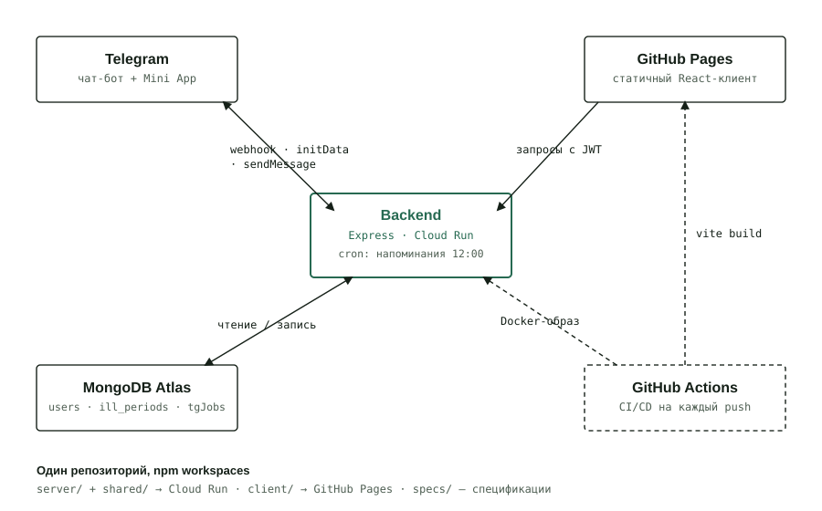

# check-health
Health tracker Web app with a Telegram bot integration. Tell the bot when a cold starts and ends, and it keeps statistics for you. Open the Mini App straight from your chat with the bot to see your full history at a glance — no sign-up, no password, no extra app to install.

Purpose:
Collect data of diseases, medical tests, show statistics

 

## Demo
Here is a working live [demo](https://elvirkin1392.github.io/check-health/)



## Links

- https://tlgrm.ru/docs/bots/api
- https://yandex.cloud/ru/docs/serverless-containers/
- https://console.yandex.cloud/folders/b1gh4gvssp6enj02a0es


## Layout

npm workspaces, one lockfile at the root:

```
server/   Express API, Telegram bot, cron jobs
client/   React Mini App (Vite)
shared/   the little both sides agree on — supported languages
specs/    specifications, one folder per feature
```

### Install

Once, from the repository root — this installs both workspaces:

```
npm install
```

### Run server
```
cp server/.env.template server/.env   # only first time, fill in the variables
npm run dev:server
```

### Run web
```
cp client/.env.template client/.env   # only first time, fill in the variables
npm run dev:client
```

### Checks

From the root, across both workspaces:

```
npm run check-ts
npm test
npm run lint
```

## Stack
React · TypeScript · Vite · Express · MongoDB Atlas · node-cron · Telegram Bot API · JWT · Jest · GitHub Actions · GitHub Pages · Yandex Cloud Serverless Containers

## Deployment

Every push to `master` runs these GitHub Actions pipelines automatically:

- **CI** — typecheck, lint, tests, build (client and server)
- **Deploy client to GitHub Pages** — builds `client/` and publishes it (skipped for server-only changes)
- **Deploy relay to Cloudflare Workers** — deploys `relay/` (only when it changes)
- **Deploy server to Yandex Cloud** — builds the root `Dockerfile`, pushes the image to Yandex Container Registry, deploys a new revision of the serverless container and points the Telegram webhook at it (skipped for client-only changes)

No manual `npm run deploy` needed for normal changes.

### Required GitHub secrets/variables

Settings → Secrets and variables → Actions:

| Name | Type | Used for |
|---|---|---|
| `YC_SA_JSON_CREDENTIALS` | Secret | Authorized key of the `check-health-deployer` service account (JSON), authenticates the Yandex Cloud deploy |
| `CHECK_HEALTH_TELEGRAM_BOT_TOKEN` | Secret | Telegram bot token, passed to the container and used to register the webhook |
| `CHECK_HEALTH_DB_HOST` | Secret | MongoDB Atlas connection string, passed to the container |
| `JWT_SECRET` | Secret | Signs login tokens, passed to the container |
| `CHECK_HEALTH_TELEGRAM_WEBHOOK_SECRET` | Secret | Verifies incoming Telegram webhook requests, passed to the container |
| `CLOUDFLARE_API_TOKEN` | Secret | Cloudflare API token from the **Edit Cloudflare Workers** template, deploys the relay |
| `CLOUDFLARE_ACCOUNT_ID` | Secret | Cloudflare account id: `5cd82f4de59bc793e97a662a59cc2802` |
| `VITE_CHECK_HEALTH_API_HOST` | Secret or Variable | Backend URL baked into the client build at compile time: `https://bbagaldqmgffr9jtangg.containers.yandexcloud.net/` |

The client build reads `VITE_CHECK_HEALTH_API_HOST` at compile time, so after changing it re-run
**Deploy client to GitHub Pages** (Actions → the workflow → Run workflow).

### Yandex Cloud resources

All in folder `default` (`b1gh4gvssp6enj02a0es`). Their ids are in `.github/workflows/deploy-yandex.yml`.

| Resource | Name | Purpose |
|---|---|---|
| Serverless container | `check-health` | Runs the server; public URL `https://bbagaldqmgffr9jtangg.containers.yandexcloud.net` |
| Container registry | `check-health` | Server images, tagged with the commit SHA |
| Service account | `check-health-deployer` | Used by GitHub Actions: `container-registry.images.pusher`, `serverless-containers.editor`, `iam.serviceAccounts.user` |
| Service account | `check-health-runtime` | Used by the container to pull its image: `container-registry.images.puller` |

The container must be publicly invocable, or neither Telegram nor the Mini App can reach it:

```
yc serverless container allow-unauthenticated-invoke --name check-health
```

Requests are still checked by the server: the webhook by Telegram's secret token, the API by JWT.

To register the webhook by hand (the deploy does it on every run), set `CHECK_HEALTH_TELEGRAM_WEBHOOK_URL`
and call `GET /api/switchOnWebhook` while logged in.

### Telegram relay

Yandex Cloud's network drops traffic to and from Telegram: Telegram cannot deliver the
webhook to the container, and the container cannot reach `api.telegram.org`. A Cloudflare
Worker in `relay/` (`https://check-health-relay.elvirkin1392.workers.dev`) sits in between:

```
Telegram ──webhook──▶ relay /api/listenWebHook ──▶ container
container ──Bot API──▶ relay /bot<id>:… ──▶ api.telegram.org
```

It keeps no state and logs nothing; the server still checks the webhook secret. Only this bot's
Bot API calls are relayed (`BOT_ID` in `relay/wrangler.toml`). The server finds it through
`CHECK_HEALTH_TELEGRAM_API_BASE`; locally that variable is empty and the server talks to
`api.telegram.org` directly.

Deploy by hand: `cd relay && npx wrangler@4.151.0 deploy` (after `npx wrangler@4.151.0 login`).

The container sleeps when there are no requests. Reminders still run on an in-process timer,
so they only fire while an instance is awake — moving them to a scheduled trigger is
[spec 006](specs/006-yandex-cloud-hosting/spec.md).
